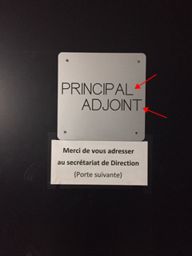

# Instruction Manual for the Tool For Awesome Talk

## Creating a New Presentation
- Duplicate the folder “conference-TAT” and rename it after your presentation.
- Delete all contents in the “slides” folder.
- Fill the “slides” folder with your presentation materials, arranged in alphabetical order.

## Viewing the Presentation
- Open Terminal.
- Drag your presentation folder onto the Terminal icon in the Dock. For example, drag the “conference-TAT” folder onto the Terminal icon.
- A Terminal window will open.
- Type the command `php -S localhost:8080`.
- Press Enter.
- Open your preferred web browser.
- Enter `localhost:8080` in the address bar.
- Your presentation should now appear.

## Adding Media
- You can place image files (JPG, PNG or GIF) in the “slides” folder. These images will be displayed full-screen in the interface.
- You can place audio files (WAV or MP3) in the “slides” folder. An audio player will appear.
- You can place video files (MP4, WebM or OGG) in the “slides” folder. The video will be displayed full-screen and can be viewed in full-screen mode.
- You can place PDF files in the “slides” folder. The PDF will open in the browser’s PDF viewer.

## Writing Text Content / Adding Images / YouTube and Vimeo Videos
- Open TextEdit or alike
- Create a new file.
- Convert it to Plain Text: Format > Make Plain Text.
- Save text slides with the `.md` extension in the `slides` folder.
- Write your content as follows (this uses Markdown; documentation is also available here: https://docs.framasoft.org/fr/grav/markdown.html).

# Main Heading
## Medium Heading
### Fairly Large, Underlined Heading
#### Large Text
##### Text
###### Smaller Text Than the Body Text

Regular text  
Regular text with **bold** and *italic* formatting  
To insert a line break, type two spaces at the end of the line.  
- You can also create lists
- Like this

### Adding a Link:
- The link itself: http://pouet.net
- A clickable link with text: [Pouet](http://pouet.net)

### Adding an Image:
  
Here, the image file `porte-1-fleche.png` is located in the “images-slides” folder, which is inside the “slides” folder.

### Adding a YouTube Video
<iframe src="https://www.youtube.com/embed/tgbNymZ7vqY" allowfullscreen width=640 height=360 ></iframe>   
Replace `https://www.youtube.com/embed/tgbNymZ7vqY` with the video’s embed URL.  
You can also replace only the video ID in the URL.

### Adding a Vimeo Video
<iframe src="https://player.vimeo.com/video/13416084" width="640" height="360" allowfullscreen></iframe>   
Replace `https://player.vimeo.com/video/13416084` with the video’s embed URL.  
You can also replace only the video ID in the URL.

## Adding a Caption to an Image
- Create a Plain Text file.
- Name it after the image, adding the `.md` extension. For example, if the image is called `image.jpg`, the caption file should be named `image.jpg.md`. 
- Write the caption in Markdown in that file.

## Exporting the Presentation
- Click the 📦-icon (export) at the bottom of the thumbnail column.
- Extract `presentation.zip` and open `index.html` in a browser. The export includes the slides, styles, scripts, theme toggle, and information button and works without PHP.
- The PHP server needs the Zip extension enabled to create the archive.

# Licence
Tool for Awesome Talks is a project by Sarah Garcin released under [GPL](https://www.gnu.org/licenses/gpl-3.0.html)

 
